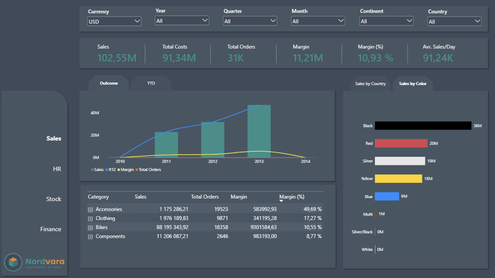
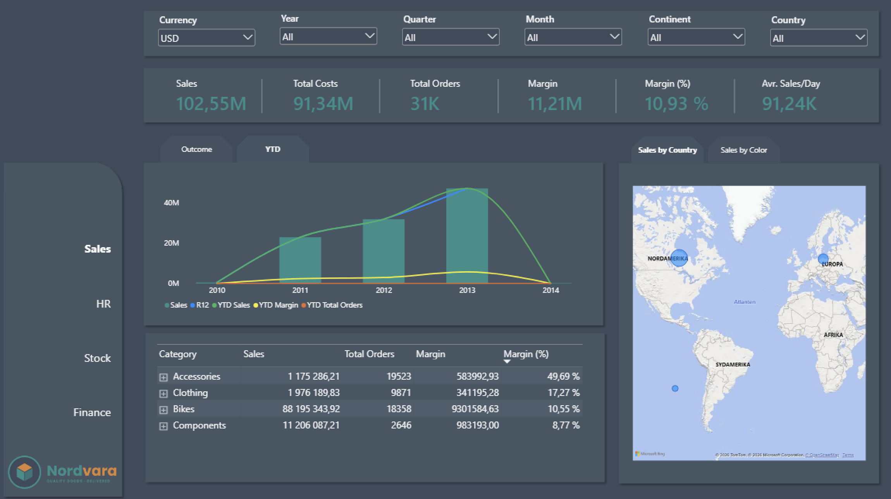
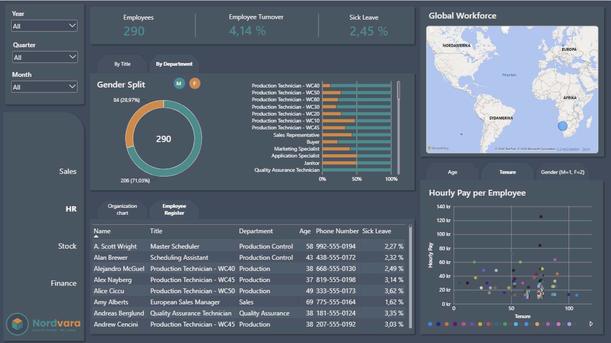
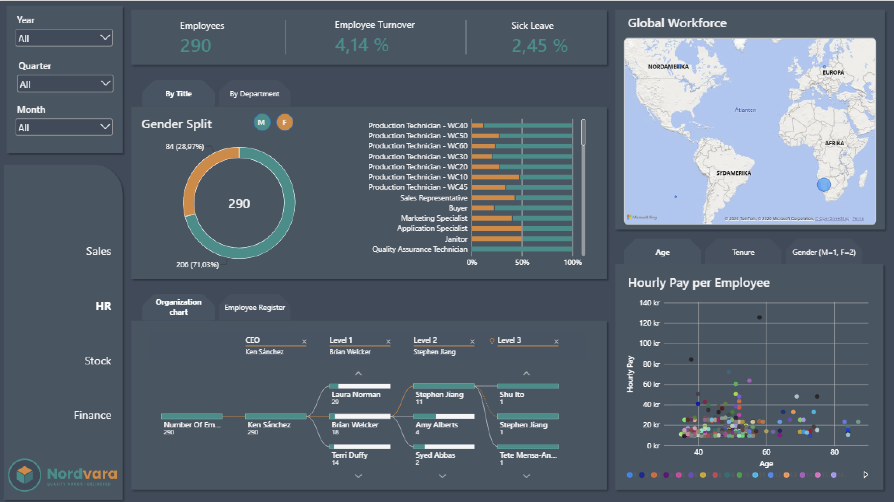
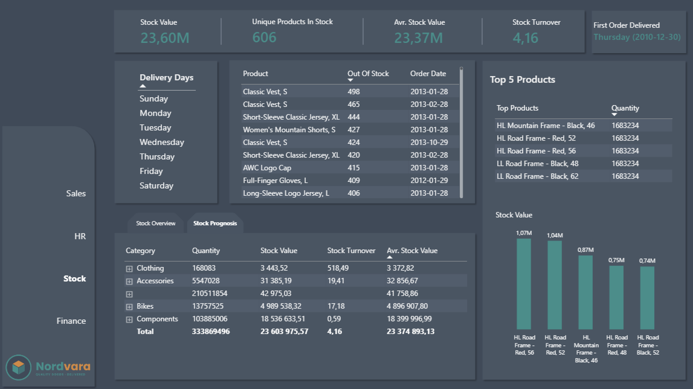
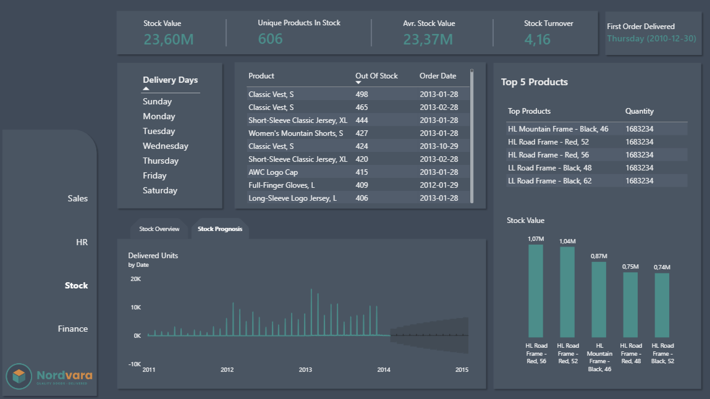
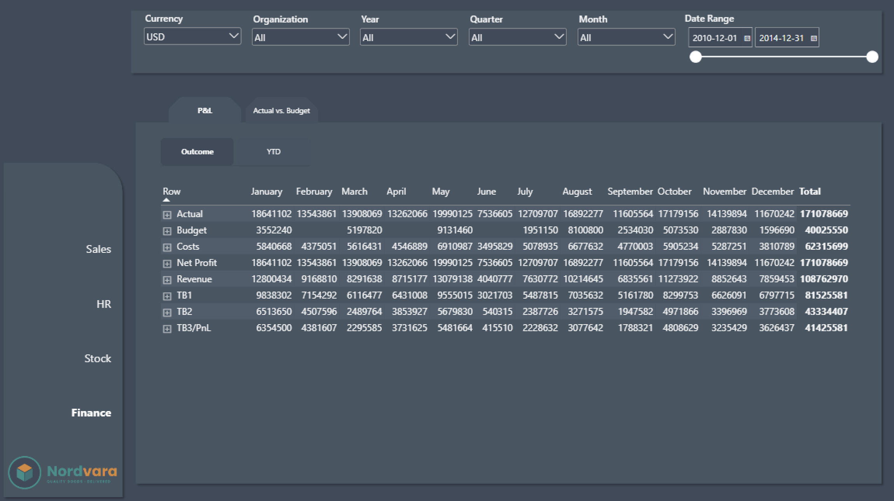
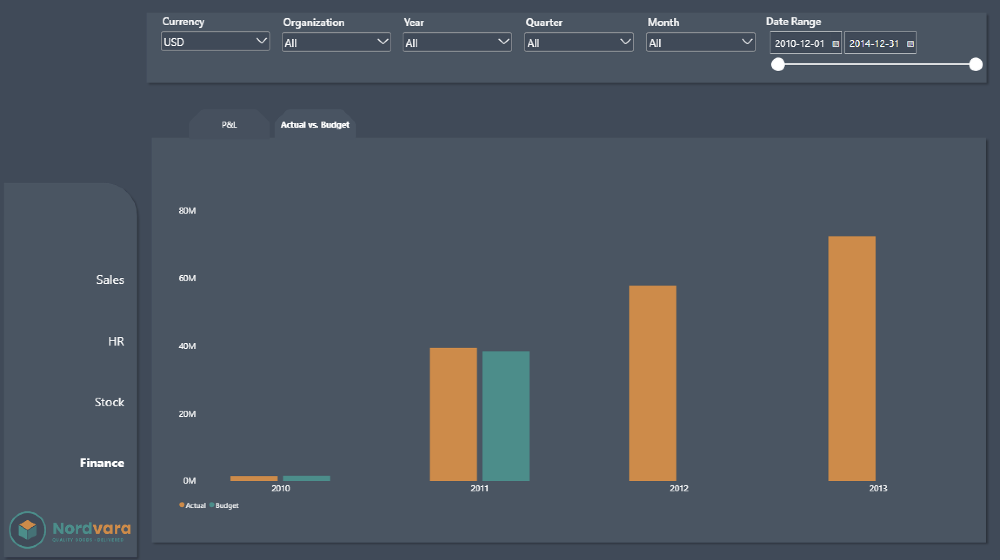

# Nordvara – Sales, HR, Stock & Finance Dashboard (Power BI)

A four-page Power BI report built as a school project in the BI Analyst program at Nackademin. The report gives a company-wide overview of **sales, workforce, inventory and financial performance** for the fictional company *Nordvara*, with navigation between pages and interactive filters.

> **Note:** The dataset is provided by the course and can't be shared, so this repo contains screenshots of the finished report only.

---

## Tools & techniques

- Power BI Desktop
- Data modelling (star schema, date table, currency table)
- Power Query for data preparation
- DAX measures (YTD, R12, turnover, margin, currency conversion etc.)
- Report design: custom navigation, tabbed visuals via bookmarks, consistent dark theme

---

## Report pages

### 1. Sales

**Purpose:** Show sales at both a high level (over time) and in detail (product, region, attribute).



- **Filters:** currency, year, quarter, month, continent, country
- **KPIs:** sales, total costs, total orders, margin, margin %, average sales per day
- **Sales over time:** actuals, rolling 12 months (R12) and year-to-date (YTD), switchable with tabs
- **Category table:** sales, orders, margin and margin % with drill-down from category to subcategory and product
- **Sales by color** and **sales by country**



---

### 2. HR

**Purpose:** Give an overview of the workforce, its composition and development.



- **Filters:** year, quarter, month
- **KPIs:** number of employees, employee turnover %, sick leave %
- **Gender split** shown in total and broken down by job title and department
- **Employee register:** name, title, department, age, phone number and sick leave
- **Global workforce map**
- **Hourly pay per employee** plotted against age, tenure and gender



- **Organization chart** showing who reports to whom, from CEO down through management levels

**KPI definitions**

| KPI | Calculation |
|---|---|
| Average employees | (employees at period start + employees at period end) / 2 |
| Employee turnover % | employees leaving in period / average employees × 100 |
| Sick leave % | sick hours / total working hours (normal working year = 1,850 h) |

---

### 3. Stock

**Purpose:** Show inventory value, efficiency and delivery patterns.



- **KPIs:** stock value, unique products in stock, average stock value, stock turnover, date of first delivered order
- **Top 5 products** by quantity and by stock value
- **Delivery days:** which weekdays deliveries occur
- **Order matching:** products that were ordered but out of stock, with order date
- **Stock by category** with drill-down



- **Forecast:** delivered units over time with a forecast for upcoming deliveries

**KPI definitions**

| KPI | Calculation |
|---|---|
| Average stock value | (opening + closing stock value) / 2 |
| Stock turnover | cost of goods sold / average stock value |

---

### 4. Finance

**Purpose:** Compare actual results to budget, per company and for the whole group, with drill-down to account level.



- **Filters:** currency, organization (company/group), year, quarter, month, date range
- **P&L table:** actual vs. budget, by month, with drill-down to account level
- **Outcome / YTD toggle** for all measures
- **Result levels:**
  - TB1 = accounts 4* and 5*
  - TB2 = TB1 + accounts 6*
  - TB3 / P&L = TB2 + accounts 8*



- **Actual vs. budget chart** over time

---

## Design choices

- **Consistent layout:** the same navigation menu, filter placement and color palette on every page
- **Tabs instead of clutter:** related views (e.g. Outcome/YTD, By Title/By Department) share the same space
- **Drill-down** where users need detail, high-level KPIs where they need an overview
- **Currency handling:** all values converted from local sale currency to any chosen currency, with a currency selector

---

## What I learned

- Building a complete multi-page report from raw requirements
- Writing measures in DAX
- Modelling data from several business areas in one report
- Designing for readability: filters, KPIs and visuals that are easy to use

---

## Repo structure

```
├── README.md
└── images/
    ├── 01-sales-outcome.png
    ├── 02-sales-ytd-map.png
    ├── 03-hr-employee-register.png
    ├── 04-hr-organization-chart.png
    ├── 05-stock-overview.png
    ├── 06-stock-forecast.png
    ├── 07-finance-pnl.png
    └── 08-finance-actual-vs-budget.png
```

---

## Author

**Stina Wallermo** – BI Analyst student at Nackademin
[GitHub](https://github.com/stinawallermo)
